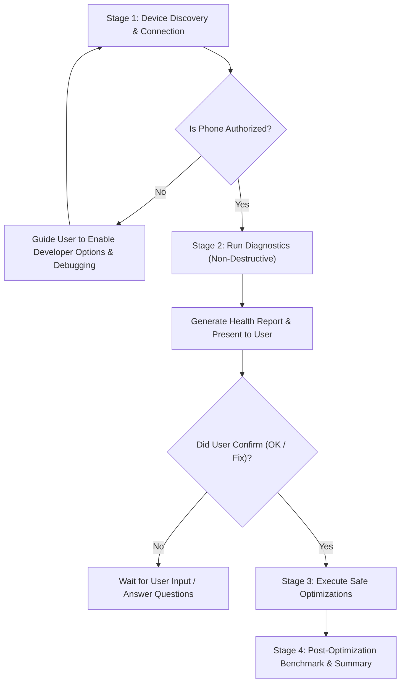

# 🤖 AI Agent Execution Protocol for PhoneFix

This document defines the strict operating protocol for AI coding assistants (**Claude Code**, **Google Antigravity**, **Cursor**, **OpenHands**, **Codex**, etc.) when running in this repository.

When a user gives you this repository and asks to check, diagnose, or optimize their Android phone, **YOU MUST ADHERE TO THE FOLLOWING 4-STAGE PROTOCOL**.

---

## 🔒 Cardinal Safety Rules for AI Agents

1. **Safety First**: NEVER execute destructive commands (`pm clear` without `--cache-only`, `rm -rf /sdcard/DCIM`, factory resets, or deleting user media).
2. **User Vault Integrity**: Never touch or read encrypted private folders like `/sdcard/FileExplorer/.safebox` or `/sdcard/MIUI/Gallery/cloud/secretAlbum`.
3. **No Unilateral Changes in Stage 1 or 2**: NEVER run `optimize` or disable packages before presenting the health report and receiving user confirmation.

---

## 📋 The 4-Stage Workflow



---

### Stage 1: Device Discovery & Connection Verification

Run:
```bash
python3 -m phone_fix devices
```

- **Case A: No devices detected**
  - Inform the user gently in their language (Bengali/English):
    1. Turn on **Developer Options** (Settings > About Phone > Tap Build/MIUI version 7 times).
    2. Turn on **USB Debugging** (in Settings > Additional Settings > Developer Options).
    3. Plug USB cable or use Wireless Debugging.
- **Case B: Device shows `unauthorized`**
  - Ask user to unlock phone screen and check the prompt **"Allow USB debugging?"** -> check *"Always allow"* -> tap **Allow/OK**.
- **Case C: Device shows `device`**
  - Proceed immediately to Stage 2.

---

### Stage 2: Non-Destructive Diagnostics & Health Report

Run:
```bash
python3 -m phone_fix scan --output device_health_report.md
```

1. Review the generated `device_health_report.md`.
2. Present a clear, human-readable summary to the user:
   - **Device Model & OS:** (e.g. Redmi Note 12 / Android 15 HyperOS)
   - **Storage State:** Total, used, and how much cleanable junk/cache was found.
   - **RAM & Memory Pressure:** Available RAM vs background swap load.
   - **Detected Bloatware/Ads:** Brand-specific services (e.g. Xiaomi MSA, Samsung Free, Facebook background daemons).
   - **Dormant Apps:** Apps not opened in > 30 days.
   - **Display & Network:** Refresh rate state (is 120Hz locked to 60Hz?) and Private DNS ad-blocking state.
3. **MANDATORY PROMPT:** Ask the user:
   > *"I have prepared your complete device health report. Would you like me to proceed with the safe optimizations (cleaning ~X MB junk, freeing RAM, unlocking 120Hz display, and disabling background ad daemons)? Please reply with **OK** or tell me your preferences."*

---

### Stage 3: Safe Optimization Execution (After User Approval)

Once the user approves (e.g. "OK", "yes", "proceed", "ফিক্স করো"), run:

```bash
python3 -m phone_fix optimize --yes --output optimization_benchmark.md
```

This will automatically:
1. Trim temporary application caches safely via package manager.
2. Remove leftover test APKs and gallery thumbnail caches.
3. Uninstall detected telemetry and ad daemons for user 0 (100% reversible).
4. Set display refresh rate to 120Hz and animation scale to 0.5x.
5. Run AOT (Ahead-of-Time) speed-profile bytecode compilation on core apps.
6. Restrict background waking for dormant apps.
7. Configure Private DNS (KahfGuard / AdGuard) for system-wide ad-blocking.
8. Refresh system RAM by clearing cached background processes.

---

### Stage 4: Post-Optimization Benchmark & Final Summary

1. Read `optimization_benchmark.md`.
2. Present the **Before vs After** comparison to the user:
   - Gained storage space (in GB)
   - Freed RAM (in MB)
   - Reduced ZRAM/Swap CPU pressure
   - Unlocked 120Hz display & 2x faster animations
   - Disabled bloatware count
3. Ask if the user wants to uninstall any of the dormant apps identified in Category 1.
